# P225 - the learned lane's architecture and its measured results

**Scope.** P225 is the **direct / learned** lane on the *shipped* cell: the bimanual
OpenArm, **one active arm per attempt**, the two raised output belts, the moving
scattered supply. It uses **no scripted skill route** (`task.run` / `_run_scripted` /
small-fruit or side handover all off). The later single-arm Franka + side-bin cell is
P226/P227 and is not part of this number.

```mermaid
flowchart LR
  subgraph SENSE["Perception - 30 Hz, the goal is measured"]
    CAM["head camera 240x424<br/>RGB + depth + instance mask"]
    FIT["trimmed sphere fit<br/>rms 0.09-0.34 mm<br/>radius held from a full cap"]
    TRK["Kalman CV tracker<br/>belt prior, 40 mm gate<br/>workcell ROI"]
    CAM --> FIT --> TRK
  end

  subgraph POLICY["p177_full - 4.60 M, DDIM-16, decision 30 Hz"]
    VIS["VisualEncoder<br/>2 frames x 5 ch, 64 px fovea<br/>-> 128"]
    COND["ConditionEncoder<br/>goal 8 -> 128<br/>proprio 26 -> 128"]
    TIME["sinusoidal t -> MLP<br/>128"]
    UNET["6 x FiLM 1-D residual blocks<br/>128,128,256,256,256,256"]
    MOE["Skill Router -> 5 experts<br/>approach/grasp/lift/place/recovery<br/>(phase gate picks one)"]
    HEAD["head -> 9-D action<br/>chunk of 4"]
    VIS --> UNET
    COND --> UNET
    TIME --> UNET
    UNET --> MOE --> HEAD
  end

  subgraph SERVO["Analytic servos - 120 Hz, measured targets only"]
    CS["contact servo<br/>aim = tracker.predict(t + lead)<br/>lead 0.10 s left / 0.20 s right<br/>one position-only IK per tick"]
    CR["committed close ramp<br/>60 ticks, dy in [-20, +14] mm"]
    CF["carry force servo 45 N<br/>bilateral: n * min(f_pads), > 4 cm only"]
    PS["place servo 0.20 m/s<br/>lift -> transit -> lower -> release"]
  end

  TRK -- "goal [x,y,z,v,dia,bin]" --> COND
  CAM -- "image" --> VIS
  TRK -- "goal" --> CS
  HEAD -- "7 joints + finger @ 30 Hz (hold 4)" --> CS
  CS --> CR --> CF --> PS
  PS --> ROBOT["OpenArm, one active arm<br/>parallel jaw, 10 N/joint cap<br/>+ 60 N direct spec"]
```

## 1. Observation / action contract

| channel | shape | content | rate |
|---|---|---|---|
| image | 2 x 5 x 128 x 128 | RGB 3 + depth + instance mask, 64 px fovea crop resized | 30 Hz |
| goal | 8 | `[fruit xyz, v(3), diameter, bin]`, **from the tracker** | every tick |
| proprio | 26 | 22 joints + active finger + 2 tactile normal forces + last finger command | every tick |
| action | 9 | 7 joint targets + finger + a recorded channel | 30 Hz (hold 4) |

Execution: `execute_steps=4` (whole chunk), DDIM 16, `FRUIT_POLICY_JOINT_CLAMP`,
`FRUIT_POLICY_TARGET_RATE=5.45 rad/s`.

## 2. The model, measured on the checkpoint

| module | structure | params |
|---|---|---:|
| VisualEncoder | Conv 5x5/2, 3x3/2 x3, GAP, Linear | 265 k (5.8 %) |
| ConditionEncoder | goal MLP 8->128->128 + proprio MLP 26->128->128, summed | 38 k |
| time | sinusoidal 128 -> 128 -> 128 | 33 k |
| backbone | 6 ConditionalBlocks, FiLM(cond 128), kernel 5 | **3.16 M (68.7 %)** |
| MoE | router 128->128->5 + 5 zero-init residual experts | **1.00 M (21.4 %)** |
| head | Conv 256->128, SiLU, Conv 128->9 | 100 k |
| **total** | | **4,595,054** |

The phase gate (`checkpoints/p146_phase/phase.pt`, 8->64->64->5) replaces the
router's argmax at inference because the closed-loop router flips to `lift` while
the fruit is still on the belt.

## 3. The analytic layers (not scripted skills)

| layer | law | measured constants |
|---|---|---|
| contact servo | `aim = tracker.predict(t + lead)`, one position-only IK/tick, gated on the aim being reached | lead 0.10 s left / 0.20 s right; gate 30 mm; window 160 ticks |
| close ramp | committed min-jerk, **two-sided** gate | 60 ticks; `dy in [-0.020, +0.014] m` |
| carry force | keep closing while `n * min(pads) < target` | 45 N, scoped `diameter > 0.040 m` |
| place | lift clear, transit at a bounded reference, lower, release | 0.20 m/s; release scored at the finger's closed->open transition |

## 4. Evaluation (three seeds, 8 episodes each, the shipped cell)

| belt | seed 77 | seed 101 | seed 202 | pooled | per placed fruit |
|---|---:|---:|---:|---:|---:|
| **0.15 m/s** | 8/8 | 7/8 | 5/8 | **20/24 = 83.3 %** | 6.8-11.1 s |
| **0.12 m/s** | 6/8 | 4/8 | 5/8 | **15/24 = 62.5 %** | 7.0-11.4 s |

- No scripted skill route; the policy owns the approach, the phase, the finger
  and the destination, the servos own the last centimetres.
- The first two 0.15 seeds read 15/16 (94 %); the **fresh** third seed reads 5/8,
  which is why the pooled 83.3 % is the number (P93's rule).
- Smaller classes: **lychee-only 3/4** (size-scoped perception floor 12 px),
  **strawberry-only 3/6** (sphere) against the spheroid's 2/6.

### Mechanism reads (not rates)

- The 0.12 residual is **runway** (`[fall] y = -0.86..-0.90`, the belt's 11.5 s
  transit against 7-11 s attempts) plus the closed **loaded slide**; the 0.15
  residual is the same loaded slide on the pear/lychee.
- The payload-loss class falls **3 -> 1 in 16 attempts** with the bilateral
  carry-force criterion; the placed legs read **one-sided contact 0.00**.
- The early-close defect (`[close] xy=339 mm`) is removed by the two-sided gate;
  the closes now read 4-21 mm.
- The foveal goal is a **null** on accuracy (engages 99 %, `err_p50` 3.0/10.8 mm
  against the full frame's 2.4/9.1); the signed error moves axis between attempts,
  so it is not a calibratable bias.
- A DAgger round has **nothing to learn on the approach**: the policy-to-expert
  joint error is **0.061 rad** median on approach frames with the fruit ahead -
  the demonstrations' own 0.065 fit floor.

### Measured negatives (all recorded, none shipped)

re-close latch (fires, converts none) - goal-y clamp (stops the chase, costs the
placements, 0/3) - selector rule far/near (a draw) - upstream belt extension
(draw with the recipe's selector, negative with the one that uses it) - fovea -
spheroid for the strawberry - 0.15 place at 0.15 m/s (slower, two place losses).

**The one-line claim**: 0.15 = **83.3 %**, 0.12 = **62.5 %** placed,
6.8-11.4 s per placed fruit, on a 0.12/0.15 m/s belt, with **no scripted skill**
in the count.
